# Architecture and workflow

This document explains how the portfolio is put together and how work flows through it:
from editing content, through the build, to a deployed GitHub Pages site. For setup
commands and editing recipes, see [README.md](README.md). For function-level reference,
every source file carries Doxygen comments (`@file`, `@brief`, `@param`, `@returns`);
generate browsable docs with `npm run docs`.

## Contents

1. [System overview](#1-system-overview)
2. [Directory map](#2-directory-map)
3. [Runtime flow: from URL to page](#3-runtime-flow-from-url-to-page)
4. [Content model](#4-content-model)
5. [Rendering pipeline: data to screen](#5-rendering-pipeline-data-to-screen)
6. [Interactive instruments](#6-interactive-instruments)
7. [Diagrams](#7-diagrams)
8. [Design system](#8-design-system)
9. [Build flow](#9-build-flow)
10. [Deployment flow](#10-deployment-flow)
11. [Routing on GitHub Pages](#11-routing-on-github-pages)
12. [Draft content workflow](#12-draft-content-workflow)
13. [Accessibility and motion](#13-accessibility-and-motion)
14. [Common workflows](#14-common-workflows)
15. [Verification checklist](#15-verification-checklist)

---

## 1. System overview

The site is a static single-page application. There is no server, database or API key:
all content is TypeScript data compiled into the bundle, and GitHub Pages serves the
built files.

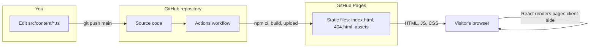

| Layer | Technology | Responsibility |
|---|---|---|
| Content | TypeScript data in `src/content/` | Everything a visitor reads: profile, projects, skills, articles |
| Presentation | React 18 components | Turning content into pages, diagrams and instruments |
| Routing | React Router 6 | Clean URLs, with the repository base path on GitHub Pages |
| Styling | One CSS file of design tokens and components | The Phosphor instrument theme |
| Build | Vite 5 and the TypeScript compiler | Type-checking, bundling, hashing assets |
| Hosting | GitHub Pages via GitHub Actions | Serving the static build |

---

## 2. Directory map

```
.github/workflows/deploy.yml   Build and deploy to GitHub Pages on every push to main
public/                        Copied as-is into the build
  favicon.svg, og-image.png    Site identity and social preview image
  media/projects/<slug>/       Project images (referenced from projects.ts)
  .nojekyll, robots.txt        Pages and crawler configuration
scripts/postbuild.mjs          Copies index.html to 404.html for deep links
scripts/doxygen-filter.mjs     Doxygen input filter: TypeScript → JavaScript, comments kept
src/
  main.tsx                     Entry: chooses the router, mounts React
  App.tsx                      Route table
  content/                     ALL editable content (see section 4)
    site.ts                    Identity, contact, education, experience, skills
    projects.ts                Projects and their sections
    articles.ts                Notebook articles; project section order
    types.ts                   Types that keep the content consistent
  components/                  Shared UI
    Layout.tsx                 Header, navigation, footer, focus management
    Oscilloscope.tsx           Hero instrument
    Multimeter.tsx             Experience readout
    LogicAnalyzer.tsx          Protocol encoder and decoder
    PcbExplorer.tsx            Interactive board map
    ProjectList.tsx            Projects as scope channels
    Blocks.tsx                 Renders content blocks
    CodeBlock.tsx, Status.tsx, ArticleList.tsx, Contact.tsx
  interactive/                 Widgets embedded in project pages
    ProtocolSim.tsx            Heartbeat/ACK state machine
    ChannelSounding.tsx        Phase-based ranging explainer
  diagrams/
    kit.tsx                    Diagram primitives (one visual language)
    index.tsx                  Project diagrams and the id → component registry
  pages/                       One component per route
  lib/
    env.ts                     Build flags and the asset() path helper
    useMeta.ts                 Per-route title and description
    highlight.ts               Tiny C/JSON syntax highlighter
  styles/global.css            Design tokens and all component styles
index.html                     HTML shell, fonts, default metadata
vite.config.ts                 Build modes and base path
Doxyfile                       API documentation generator settings
```

---

## 3. Runtime flow: from URL to page

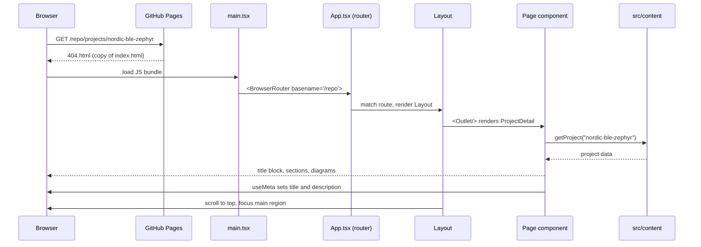

Key points:

- `main.tsx` picks the router. GitHub Pages builds use `BrowserRouter` with
  `basename = BASE_URL`. The single-file preview uses `MemoryRouter`.
- `App.tsx` nests every page inside `Layout`. The catch-all `*` route renders `NotFound`.
- Pages read content through plain imports and helpers such as `getProject()` and
  `getArticle()`. There is no data fetching at runtime.
- `useMeta()` updates the document title, description, Open Graph tags and robots
  directive on each route change.

---

## 4. Content model

All content lives in `src/content/`, typed by `types.ts`. Components never hard-code
personal facts; they read them from here.

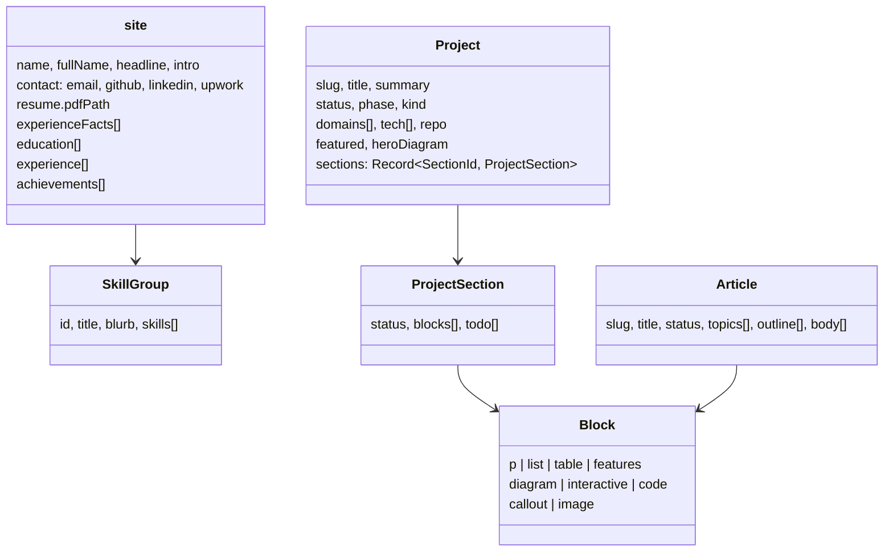

### Honesty rules built into the model

| Mechanism | Effect |
|---|---|
| `null` personal fields | Render as a dashed "Add …" marker or are hidden; nothing is invented |
| `Status` on projects and features | Every claim says whether it is implemented, in progress, planned or a concept |
| `illustrative` on diagram blocks | Adds a caption flag when a diagram shows a general pattern, not a specific product |
| `todo` on sections | Lists what is still missing; never shown on the live site |
| `achievements` | Only measured results you have stated |

### Project page structure

Every project page uses the same ten sections, in the order set by
`projectSectionOrder` in `articles.ts`:

`overview → problem → role → architecture → hardware → firmware → challenges → debugging → verification → lessons`

A section appears only if it has `blocks`. This keeps pages honest and consistent while
letting each project fill only what it can support.

---

## 5. Rendering pipeline: data to screen

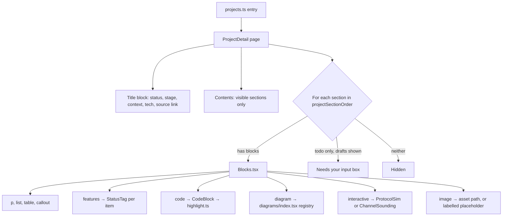

Lists use the same data: `ProjectList` (home and projects page) reads `status` to pick
each channel's trace shape, and `ArticleList` reads article `status` to decide whether a
title links anywhere.

---

## 6. Interactive instruments

Each instrument is self-contained, keeps its own React state, and has no external
dependencies. Signals and data are either generated from real rules (the logic analyzer)
or clearly labelled as simulated.

### Oscilloscope (`components/Oscilloscope.tsx`)

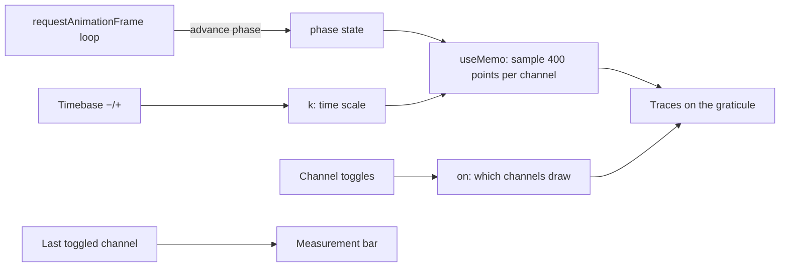

- Each channel has a signal model `fn(x)` returning amplitude in divisions, a vertical
  offset, and fixed measurements derived from the model at 100 µs/div.
- Run/Stop starts or cancels the animation-frame loop. The scope starts stopped when
  reduced motion is requested.

### Logic analyzer (`components/LogicAnalyzer.tsx`)

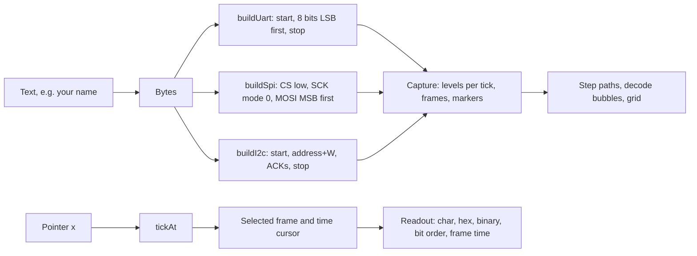

Time is sampled at two ticks per bit, so clock edges can fall mid-bit for SPI and I²C.

### Multimeter (`components/Multimeter.tsx`)

Four dial positions (EXP, FOCUS, EDU, LOC). The knob is a real control (`role="slider"`):
click or tap advances to the next position, dragging turns it and snaps to the nearest
position (`nearestMode()` maps the pointer angle), and arrow keys, Home and End work when
it is focused. The labels around the dial are buttons that jump straight to a position.
The readout updates in an `aria-live` region.

### PCB explorer (`components/PcbExplorer.tsx`)

The board (Rev B) is grouped into five areas: MCU and clock, flash, radio, power, and
debug and test. Hover previews an area; click or keyboard focus pins it. CSS animates
dashes along the copper (amber data, cyan power, magenta RF, blue debug) and blinks the
status LED.

The drawing follows real layout practice so it reads correctly to a hardware engineer:

| Practice | How the board shows it |
|---|---|
| Straight power entry | Battery + runs straight into the regulator's VIN, battery − straight into its GND pin |
| Tombstone avoidance | Capacitors on the power rail stand off the wide trace and connect through thin necks of equal width on both pads |
| Decoupling | A 100 nF capacitor beside each MCU supply pin, plus a bulk capacitor at the power entry |
| Crystal | Placed against the MCU's clock pins, with a load capacitor on each side to ground |
| Antenna keep-out | No vias, parts or mounting hardware near the edge antenna; three mounting holes |
| Ground stitching | A sparse ring of vias around the board edge |
| Test access | Pads for 3V3, GND, SWDIO, SWCLK, CLK (SPI clock, not the crystal), RX and TX, each beside its net |
| Non-crossing routes | SPI and SWD traces are ordered so no run crosses another on the same layer |

`STITCH` holds the stitching-via coordinates, and `GndVia` draws both part-ground and
stitching vias.

### Heartbeat simulator (`interactive/ProtocolSim.tsx`)

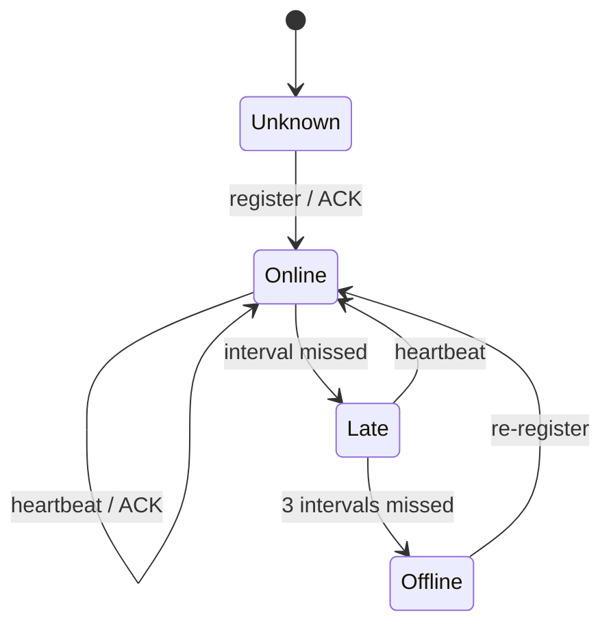

A pure `reducer` applies `register`, `heartbeat`, `expire`, `drop`, `link`, `step` and
`reset` actions. "Run automatically" dispatches `step` every 1.4 s. The highlighted
state in the diagram comes from the same state object, so the picture and the logic
cannot disagree.

### Channel Sounding explainer (`interactive/ChannelSounding.tsx`)

For each of 40 tones (2402–2480 MHz, 2 MHz apart): the phase is 4π·f·d/c plus seeded
Gaussian noise, wrapped to 0–2π. The phases are unwrapped across frequency and fitted
by least squares, and the slope gives the estimated distance. Increasing the noise
shows unwrapping failing, which is the real limitation of phase-only ranging.

---

## 7. Diagrams

Diagrams are hand-built SVG React components, not images, so they scale, theme and stay
accessible.

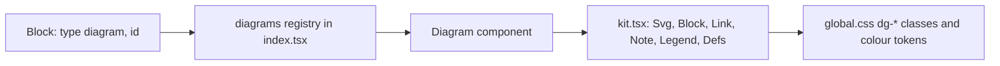

- `Svg` adds an accessible title and description, and a scrollable frame on narrow
  screens.
- `Block` kinds: `mcu`, `periph`, `fw`, `ext`, `debug`, `power`. `Link` kinds: `data`,
  `power`, `debug`, `radio`, `audio`. Every diagram therefore uses one visual language.
- To add a diagram: write a component, register it, add its id to `DiagramId` in
  `types.ts`.

---

## 8. Design system

The theme ("Phosphor") treats the site as an instrument panel.

| Token | Value | Meaning |
|---|---|---|
| `--bg`, `--bg-2`, `--bg-3` | Warm near-black panels | Surfaces |
| `--screen`, `--graticule` | Instrument screen and grid | Plots, diagrams, readouts |
| `--ch1` amber | Signal and data | Primary accent, CH1 |
| `--ch2` cyan | Power and audio | CH2 |
| `--ch3` magenta | RF | CH3 |
| `--ch4` blue | Debug, concepts | CH4 |
| `--green` | Running, implemented | Status LED, implemented tags |

- Type: Martian Mono for headings and readouts, Inter Tight for body text.
- Buttons and navigation are styled as hardware keys, with a pressed state.
- All styles live in `src/styles/global.css`, in labelled sections. Later sections
  ("v2", "v3") refine earlier ones, so read the file top to bottom.

---

## 9. Build flow

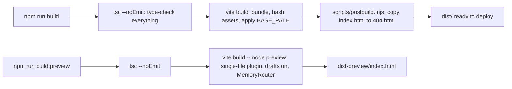

| Variable | Set by | Used for |
|---|---|---|
| `BASE_PATH` | Workflow, from the Pages configuration | Asset and router base, e.g. `/portfolio/` |
| `VITE_SITE_URL` | Workflow, from the Pages URL | Absolute Open Graph image and URL in `index.html` |
| `VITE_PREVIEW` | `.env.preview` | Switches to `MemoryRouter` |
| `VITE_SHOW_DRAFTS` | `.env.preview` | Shows todo prompts and draft articles |

---

## 10. Deployment flow

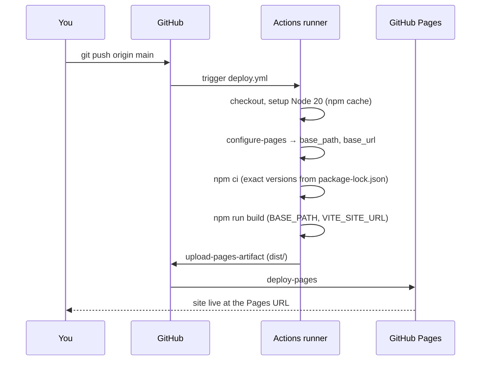

The workflow needs **Settings → Pages → Source: GitHub Actions**. It works unchanged for
project sites (`/repo/`), user sites (`username.github.io`) and custom domains.

---

## 11. Routing on GitHub Pages

GitHub Pages cannot route clean URLs to an app, so the build relies on its 404 behaviour:

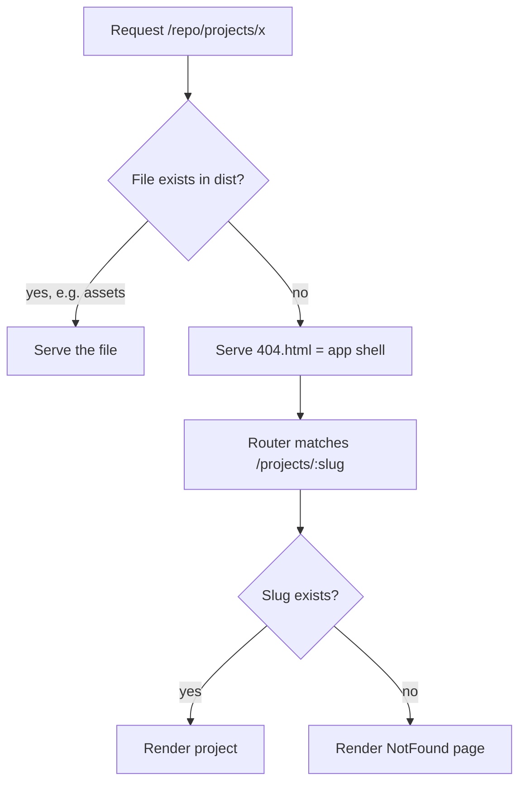

Trade-off: deep links return HTTP 404 even though the page renders correctly. Visitors
are unaffected; search crawlers may rank deep pages lower. Pre-rendering each route
would remove this if it ever matters.

Keep in mind that a folder in `public/` with the same name as a route would shadow it.
That is why project images live in `public/media/`, not `public/projects/`.

---

## 12. Draft content workflow

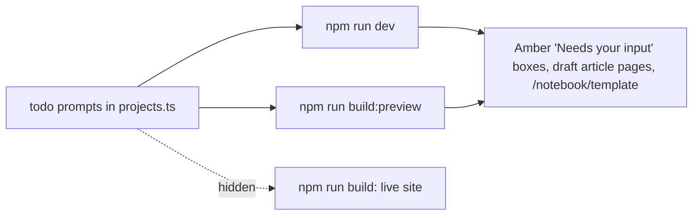

`showDrafts` in `lib/env.ts` is true in development and in the preview build. On the
live site, sections with only `todo` prompts disappear, planned articles are listed
without links, and the template route does not exist.

Typical cycle: run `npm run dev`, read the amber prompts, write real content into
`blocks`, delete the prompt, and push.

---

## 13. Accessibility and motion

- **Navigation:** a skip link, visible focus states on every control, and focus moved to
  the main region after each route change.
- **Instruments:** controls are real `<button>`s with `aria-pressed`. Readouts use
  `aria-live`. SVGs have titles and descriptions; decoration is hidden from assistive
  technology.
- **Motion:** `prefers-reduced-motion` disables all CSS animation. The oscilloscope starts
  stopped and the logic analyzer skips its reveal.
- **Layout:** wide diagrams and tables scroll inside their own frames, with a hint on
  narrow screens, so the page body never scrolls sideways.

---

## 14. Common workflows

### Update personal details
Edit `src/content/site.ts` → `npm run dev` to check → commit and push.

### Add a project
1. Add an object to `projects` in `src/content/projects.ts` (copy an existing one).
2. Fill only the sections you can support. Add `todo` prompts for the rest.
3. Optional: add images under `public/media/projects/<slug>/`, a diagram in
   `src/diagrams/index.tsx`, `featured: true` for the home page, and `repo` for a source
   link.
4. `npm run build` to type-check, then push.

### Publish a notebook article
Add a `body` to the article in `articles.ts`, set `status: 'published'` and a
`published` date, preview it in `npm run dev`, then push.

### Add an interactive widget
1. Create the component in `src/interactive/`, with Doxygen comments on every function.
2. Add its id to `InteractiveId` in `types.ts`.
3. Render it from the `interactive` case in `components/Blocks.tsx`.
4. Embed it in a project section with `{ type: 'interactive', id, caption }`.

### Regenerate API documentation

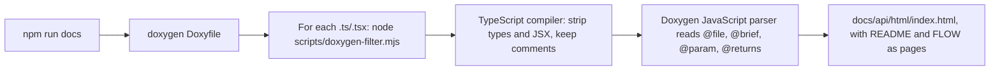

Requires Doxygen and `npm ci`. Open `docs/api/html/index.html` afterwards.

---

## 15. Verification checklist

Before pushing a significant change:

- [ ] `npm run build` passes (type-check, bundle, 404 copy).
- [ ] Home page instruments respond: channel toggles, timebase, Run/Stop, dial, protocol
      switch, PCB areas.
- [ ] A project deep link loads directly, and an unknown slug shows the 404 page.
- [ ] Layouts hold at about 390 px wide, with diagrams scrolling inside their frames.
- [ ] Keyboard only: Tab reaches every control, with focus visible.
- [ ] No placeholder shows on the live build that should have been filled in.
- [ ] New functions have Doxygen comments (`@brief`, `@param`, `@returns`).
